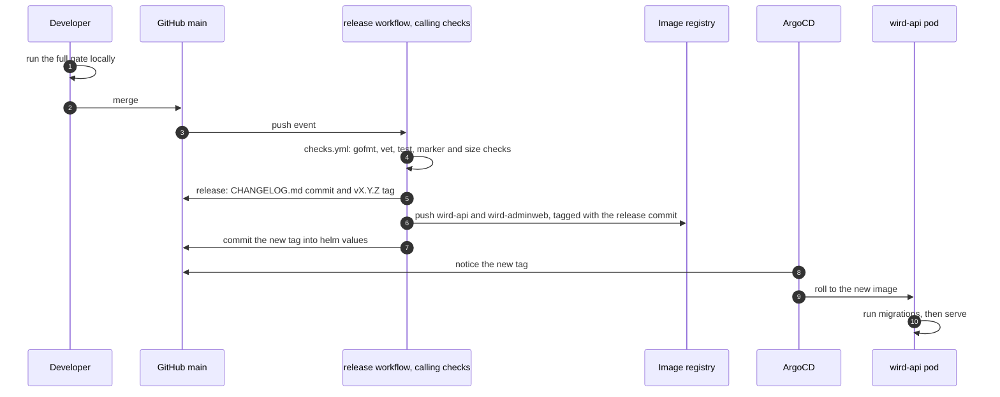
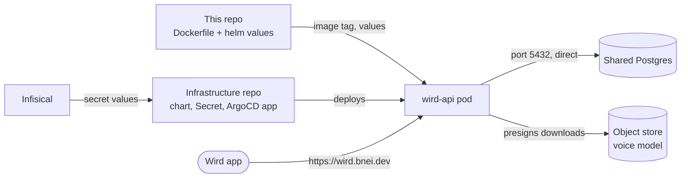
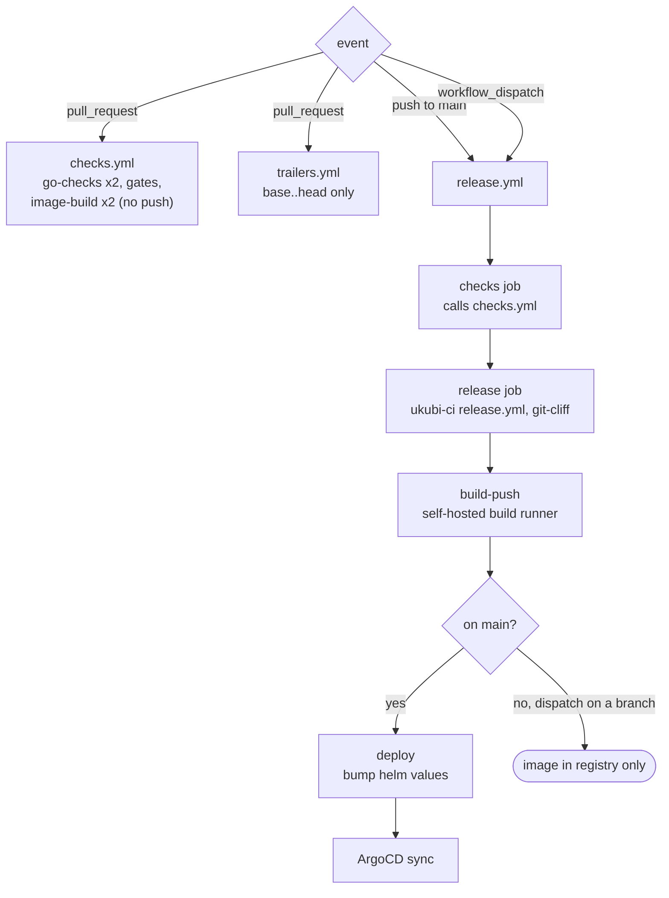
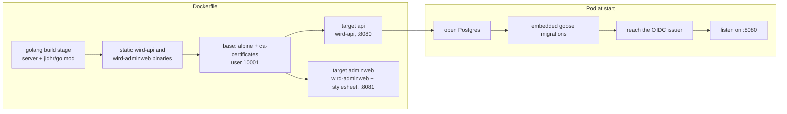

# Deploy

> From a merged commit to a running pod: CI checks, a semver release, two container images tagged with the commit, a helm values bump, and ArgoCD. Level L1 · Parent [Overview](../README.md) · Children none

## Black box

A merge to `main` is a release. Nobody types a version or presses a button. CI runs the Go half of **the gate**, cuts the next version from the commit subjects (a `vX.Y.Z` tag and a `CHANGELOG.md` entry), builds two container images from one Dockerfile, `wird-api` and `wird-adminweb`, and writes their tag into this repo. ArgoCD sees the new tag and rolls the pod. A pull request runs the checks, builds both images without pushing them, and stops there.

| In | Out | Depends on |
|---|---|---|
| A push to `main` | A `vX.Y.Z` tag, and a new `wird-api` pod answering on `https://wird.bnei.dev` that says that version at `/version` | GitHub Actions, a self-hosted build runner, the cluster's image registry |
| A pull request | A pass or fail on the Go checks, both image builds and the commit rules, nothing deployed | GitHub-hosted runners, a throwaway Postgres 18, and the shared workflows in [ukubi-ci](https://github.com/MohammadBnei/ukubi-ci) |
| The database address and object store keys | Environment variables in the pod | A Kubernetes Secret assembled outside this repo, from Infisical |
| Any pull request or push to `main` | A pass or fail on doc links and diagrams | The `docs` workflow |



Only the API is deployed through this pipeline today. The admin web image is built and its tag bumped on every release, but its values file does nothing until the infrastructure repo registers it ([Admin web](adminweb.md#deployment)). The app is built and installed outside this pipeline. jidhr is built by nothing and deployed by nothing.



## White box





### 1. What triggers a release

`release.yml` runs on pushes to `main` and by hand. Pushes that only touch markdown or `helm/` are ignored. That stops the deploy job's own commit from starting another release. Two runs in flight on the same branch cancel the older one, so the newest tag always wins. A run on another branch never cancels `main`'s.

The filter has a cost. A Markdown-only push is not released, and neither is a code commit whose run sees a human commit land after it: that run leaves the newer commits to their own run, which a Markdown-only push never gets. The next code push releases them all. To release now, run `gh workflow run release.yml --ref main` ([ADR 0041](../adr/0041-one-version-line-cut-by-git-cliff.md#consequences)).

Pull requests do not run `release.yml`. They run `checks.yml` (the Go half of the gate and two image builds) and `trailers.yml` (the commit rules). Both are short callers of the reusable workflows in [ukubi-ci](https://github.com/MohammadBnei/ukubi-ci), pinned by commit hash.

```yaml
on:
  workflow_dispatch:
  push:
    branches:
      - main
    paths-ignore:
      # The deploy job's own bump touches helm/. Pushes made with the built-in
      # GITHUB_TOKEN do not trigger workflows either, so the loop is closed
      # twice — the same belt and braces editable-blog uses.
      - '**.md'
      - 'helm/**'
    tags-ignore:
      - '*'
```

[release.yml:47-59](../../.github/workflows/release.yml#L47-L59) · concurrency at [release.yml:65-67](../../.github/workflows/release.yml#L65-L67)

### 2. The checks: the Go half of the gate

`checks.yml` runs on every pull request, and `release.yml` calls it before it builds anything. It calls the shared `go-checks` workflow once per Go module: `gofmt`, `go vet`, then `go test -race -count=1 -p 1`. For `server` it starts Postgres 18 from the repo's own `docker-compose.yml` first. Before the tests run, it sets `GOWORK=off` and `GOTOOLCHAIN=local` and builds every package of the module, so a local `go.work` cannot hide a missing require in `server/go.mod`, a module asking for a newer Go fails instead of downloading one, and every binary still links. Two shell checks follow in the `gates` job: every marker comment carries an issue number, and `corpus.db` stays under 60 MB.

```yaml
  server:
    uses: MohammadBnei/ukubi-ci/.github/workflows/go-checks.yml@e784a69d5fe0b258b1b6899f89d42ee87eb89d5c # v0.2.1
    with:
      working-directory: server
      test-flags: '-p 1'
      pre-test: |
        docker compose up -d --wait postgres
        export GOWORK=off GOTOOLCHAIN=local
        echo GOWORK=off >> "$GITHUB_ENV"
        echo GOTOOLCHAIN=local >> "$GITHUB_ENV"
        go -C server build ./...
```

[checks.yml:24-34](../../.github/workflows/checks.yml#L24-L34) · gates job [checks.yml:48-69](../../.github/workflows/checks.yml#L48-L69) · image builds on pull requests [checks.yml:73-85](../../.github/workflows/checks.yml#L73-L85)

On a pull request the two images are also built, without pushing, on GitHub-hosted runners, so a Dockerfile that no longer builds fails before the merge. The commit rules live in [trailers.yml](../../.github/workflows/trailers.yml): Conventional subjects, and no AI attribution of any kind.

Only part of the Flutter half of the gate runs in CI: `app-checks.yml` runs `flutter analyze` and the tests minus the goldens on pull requests that touch `app/`. The goldens and the e2e journeys need fvm, a Mac and a device, and the runners have none of them. That is why you run `./scripts/qa.sh` yourself before you push. The one Go test that drives the Flutter client skips itself when fvm is missing: [zz_gate_e2e_test.go:24](../../server/internal/api/zz_gate_e2e_test.go#L24).

### 3. The release, then the image

After the checks, the `release` job calls ukubi-ci's `release.yml`. git-cliff reads the Conventional Commit subjects since the last `vX.Y.Z` tag. A `feat` raises the minor version, anything else the patch, and a breaking change at `0.x` the minor. It writes the section into `CHANGELOG.md`, commits `chore(release): vX.Y.Z` and pushes the tag with it in one push. On a branch it is a dry run: the run summary says what it would release, and nothing is pushed. If it fails, nothing is built.

```yaml
  release:
    needs: checks
    permissions:
      contents: write # pushes the chore(release) commit and the tag
    uses: MohammadBnei/ukubi-ci/.github/workflows/release.yml@e784a69d5fe0b258b1b6899f89d42ee87eb89d5c # v0.2.1
```

[release.yml:97-101](../../.github/workflows/release.yml#L97-L101)

`build-push` never runs on a pull request, because a pull request has nothing to push; `release.yml` does not run on one at all. It checks out the release commit and tags the image with the first 12 characters of its hash. There is no `latest` tag. The version goes in as a build-arg instead, checked first: `X.Y.Z` for a release, `X.Y.Z+<sha>` on `main` when nothing was released, `X.Y.Z-dev+<sha>` on a branch ([release.yml:184-199](../../.github/workflows/release.yml#L184-L199)).

```yaml
      - name: Compute the image tag
        id: tag
        run: echo "value=$(git rev-parse --short=12 HEAD)" >> "$GITHUB_OUTPUT"
```

[release.yml:124-126](../../.github/workflows/release.yml#L124-L126)

It builds with buildah on a runner that has no cluster access, then pushes to the cluster's registry. The registry password is read from Infisical over OIDC at build time. It is never stored in the repo.

Both images are built from the same Dockerfile, one target each, in one job and from one commit. `--layers` lets the second build reuse the first one's build stage instead of compiling both binaries again; the cached layers are left to the build box's weekly prune.

```yaml
          for target in api adminweb; do
            image="$IMAGE"; [ "$target" = adminweb ] && image="$ADMIN_IMAGE"
            sudo buildah bud \
              --layers \
              --isolation chroot \
              --format docker \
              --target "$target" \
              --build-arg "VERSION=$VERSION" \
              -t "$REGISTRY/$image:$TAG" \
              .
            sudo buildah push --tls-verify=false "$REGISTRY/$image:$TAG"
          done
```

[release.yml:210-221](../../.github/workflows/release.yml#L210-L221) · build runner [release.yml:103-108](../../.github/workflows/release.yml#L103-L108) · password step [release.yml:136-147](../../.github/workflows/release.yml#L136-L147)

### 4. One binary per image

The Dockerfile builds inside the `server` module and copies `jidhr/go.mod` beside it, because `server/go.mod` replaces jidhr with `../jidhr` ([ADR 0035](../adr/0035-server-takes-jidhr-from-the-same-commit.md)). There is no `go.work`. It builds two binaries, `server/cmd/api` and `server/cmd/adminweb`. Each final image holds one of them. The public page is part of that binary: `server/internal/site/static` is embedded, so it ships with every image and needs no other workload ([ADR 0018](../adr/0018-the-public-site-is-served-by-the-api.md)). The `app/` folder is never copied, so the bundled **corpus** cannot end up in the image. CGO is off, so the binaries are static. The one file outside the Go tree that is copied is the Nocturne stylesheet, which admin web reads at start. It is copied in the admin web stage rather than the build stage, so a stylesheet edit does not rebuild both binaries ([Dockerfile:66](../../Dockerfile#L66)). The version build-arg is written into `server/internal/buildinfo/version.txt` before the build, because the binaries embed it, and set as the `org.opencontainers.image.version` label in the shared base ([Dockerfile:37-38](../../Dockerfile#L37-L38), [Dockerfile:57-58](../../Dockerfile#L57-L58)).

```dockerfile
RUN CGO_ENABLED=0 go build -trimpath -ldflags='-s -w' -o /out/wird-api ./cmd/api \
 && CGO_ENABLED=0 go build -trimpath -ldflags='-s -w' -o /out/wird-adminweb ./cmd/adminweb
```

[Dockerfile:42-43](../../Dockerfile#L42-L43)

Both final images start from one Alpine base, for two reasons. It carries CA certificates, which the OIDC client needs to fetch the issuer's keys over HTTPS. And it keeps a shell for debugging. The process runs as an unprivileged user. The `api` target comes last, so a plain `docker build .` still produces `wird-api`.

```dockerfile
FROM base AS adminweb
COPY --from=build /out/wird-adminweb /usr/local/bin/wird-adminweb
# adminweb reads the Nocturne stylesheet from disk at start and refuses to run
# without it. Copied by name, like everything else here, and in this stage
# rather than the build one, so a stylesheet edit does not rebuild both
# binaries. .dockerignore lets this one file through.
COPY docs/design/nocturne-styles.css /usr/share/wird/nocturne-styles.css
ENV NOCTURNE_CSS=/usr/share/wird/nocturne-styles.css
EXPOSE 8081
ENTRYPOINT ["/usr/local/bin/wird-adminweb"]
```

[Dockerfile:60-69](../../Dockerfile#L60-L69) · the `api` target [Dockerfile:71-75](../../Dockerfile#L71-L75) · the shared base [Dockerfile:50-54](../../Dockerfile#L50-L54)

### 5. Bump the tag, and only after the push

`deploy` runs on `main`, from a push or a dispatch, once both images exist. It rewrites the tag line of `helm/values.yaml` and of `helm/adminweb-values.yaml`, to the same commit, and commits both. Bumping earlier would let ArgoCD pull a tag that is still being built. If the edit silently matches nothing, the job fails instead of going green.

```yaml
          for f in helm/values.yaml helm/adminweb-values.yaml; do
            sed -i -E "s/^(  tag: \")[^\"]+(\")/\1${TAG}\2/" "$f"
            grep -q "^  tag: \"${TAG}\"$" "$f" || {
              echo "::error::image.tag was not bumped in $f — check the sed against the file's actual indentation"
              exit 1
            }
          done
```

[release.yml:263-269](../../.github/workflows/release.yml#L263-L269) · commit and push [release.yml:274-285](../../.github/workflows/release.yml#L274-L285) · the lines it edits [values.yaml:23](../../helm/values.yaml#L23), [adminweb-values.yaml:16](../../helm/adminweb-values.yaml#L16)

A dispatch on `main` deploys like a push, because it cut a release. A dispatch on another branch builds and pushes both images but skips this job, so it never deploys.

### 6. What the pod is told

`helm/values.yaml` is the API's deployment file. The chart itself lives in the infrastructure repo, and ArgoCD there reads this file. Admin web has its own, `helm/adminweb-values.yaml`, described on [its page](adminweb.md#deployment). It sets the host, the port, and health probes on `/healthz`, a route that answers without a token.

```yaml
  hostname: wird.bnei.dev
```

[values.yaml:45](../../helm/values.yaml#L45) · probes [values.yaml:49-60](../../helm/values.yaml#L49-L60) · the route [api.go:82](../../server/internal/api/api.go#L82)

Values that are not secret are written in the file: the OIDC issuer and audience, and the Android app-link fingerprint ([values.yaml:118-158](../../helm/values.yaml#L118-L158)). Everything secret arrives from one Kubernetes Secret, loaded whole with `envFrom` ([values.yaml:114-116](../../helm/values.yaml#L114-L116)). That Secret is built in the infrastructure repo from Infisical. It holds the database address and the object store keys for the voice model. This repo names only that Secret. It never mounts a whole Infisical project, which would hand the pod every password on the platform ([values.yaml:109-113](../../helm/values.yaml#L109-L113)).

The API refuses to start on a configuration that is only partly there ([ADR 0036](../adr/0036-each-binary-refuses-a-partial-configuration.md)). A Secret row that renders empty, such as one of the four object store values, is a pod that exits with `config refused` naming the variable, not a healthy pod whose Download button answers 503. The chart's default rolling update keeps the old pod serving while the new one crashloops, so ArgoCD can show Synced with a rollout that never finished: check that the new ReplicaSet is Ready.

The pod runs one replica. The API runs two cleanup timers inside its own process, and two replicas would race them ([values.yaml:72-76](../../helm/values.yaml#L72-L76)).

### 7. Postgres, and the first thing the pod does

The database is a shared Postgres, not one of its own. The pod connects straight to port 5432, not through the connection pooler, because transaction pooling breaks pgx's prepared statements and goose's advisory lock ([ADR 0005](../adr/0005-deploying-the-api.md#the-database-comes-from-infisical-assembled-in-one-place)).

On start, the API opens the database and runs the migrations embedded in the binary before it serves anything. There is no migration job and no goose binary.

```go
func Open(ctx context.Context, url string) (*Store, error) {
	pool, err := pgxpool.New(ctx, url)
	if err != nil {
		return nil, err
	}
	if err := Migrate(ctx, url); err != nil {
		pool.Close()
		return nil, err
	}
	return New(pool), nil
}
```

[store.go:31-41](../../server/internal/store/store.go#L31-L41) · called from [main.go:63](../../server/cmd/api/main.go#L63)

### 8. Knowing your commit is live

ArgoCD can report "Synced Healthy" for a while after the bump, against the revision it saw before. To check a release, call `https://wird.bnei.dev/version`, which answers the version the running binary was built as, and compare it with the newest tag. Or compare the image tag the running Deployment uses with the tag in `helm/values.yaml`, or call the route you changed ([ADR 0005](../adr/0005-deploying-the-api.md#consequences)).

### 9. The docs workflow

A second workflow, `docs`, runs on every pull request and every push to `main`, whatever the change touches. It checks relative links and heading anchors offline with lychee. Then it runs `scripts/docs-check.sh`, which checks `#L` line links against file lengths and renders every mermaid block. On a pull request it also warns when a change edits code that a doc links into.

```yaml
      - name: Line anchors, mermaid, and links into changed code
        env:
          DOCS_BASE: ${{ github.event_name == 'pull_request' && format('origin/{0}', github.base_ref) || '' }}
        run: scripts/docs-check.sh
```

[docs.yml:35-38](../../.github/workflows/docs.yml#L35-L38) · lychee step [docs.yml:18-29](../../.github/workflows/docs.yml#L18-L29)

## Why it is this way

- [ADR 0005](../adr/0005-deploying-the-api.md) — one binary per image, the commit hash as tag, secrets assembled in one place, and only the Go half of the gate in CI.
- [ADR 0041](../adr/0041-one-version-line-cut-by-git-cliff.md) — one version line cut by git-cliff, carried by the image and its binaries, and shipped by the app.
- [ADR 0026](../adr/0026-reports-are-triaged-and-turned-into-issues.md) — the operations view became a second image from the same build, inert until the infrastructure work it lists is done.
- [ADR 0018](../adr/0018-the-public-site-is-served-by-the-api.md) — the public page is embedded in that same image, and the APK is published by digest-named key.

### Publishing the Android build

The page's Download button answers 503 until a build is published. The release button publishes one: [`release-app.yml`](../../.github/workflows/release-app.yml) checks the app and picks the newest release tag, then [`apk.yml`](../../.github/workflows/apk.yml) builds and signs the APK, uploads it to the models bucket as `android/wird-<first 12 of its sha256>.apk`, and sets `WIRD_APK_KEY`, and `WIRD_APK_VERSION` beside it for the page to print, in `helm/values.yaml` on main. ArgoCD does the rest. [Releasing the APK](../guides/releasing-the-apk.md) walks through it, and [ADR 0019](../adr/0019-the-apk-is-built-on-a-tag-and-published-by-ci.md) [ADR 0022](../adr/0022-a-release-is-cut-by-one-button-from-the-pubspec.md) and [ADR 0041](../adr/0041-one-version-line-cut-by-git-cliff.md) record why.

Never overwrite a published key: a phone resuming a download would get half of one build and half of another. A new build is a new key.
- [ADR 0008](../adr/0008-the-recogniser-is-served-from-wirds-own-host.md) — the pod also answers voice model downloads, so the object store keys joined the Secret.
- [ADR 0011](../adr/0011-two-doc-families.md) — why the human docs have a workflow of their own.

## Go deeper

- [API](api.md) — what the deployed binary serves.
- [Getting started](../guides/getting-started.md) — run the gate and the API on your own machine.
- [Tour: shipping a change](../tours/shipping-a-change.md) — this pipeline, walked end to end.
- [Toolchain](../toolchain.md) — what the gate expects on a developer machine.
