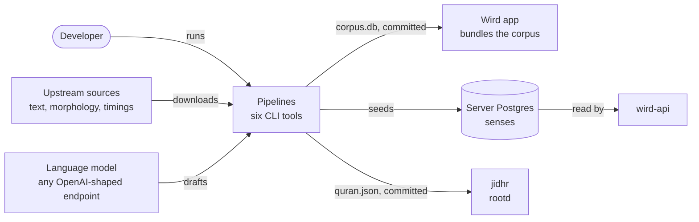
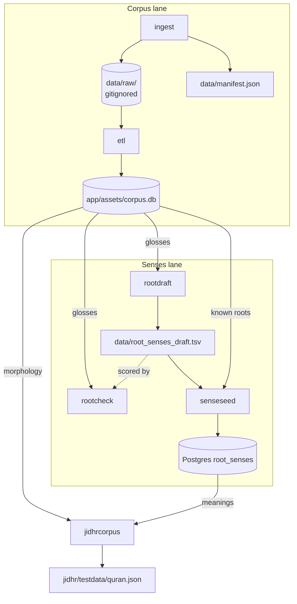

# Pipelines

> The offline tools that build the corpus, draft the senses and export jidhr's data. Level L1 · Parent [Overview](../README.md) · Children [Corpus](pipelines/corpus.md), [Senses](pipelines/senses.md)

## Black box

The pipelines are six command-line tools that run on a developer's machine, never in the deployed image. Two of them turn licensed upstream data into the **corpus** the app bundles. The others draft the **senses** of each **root**, check them, load them into the server's Postgres, and export a file for **jidhr**. A person runs them by hand when the data has to change.

| In | Out | Depends on |
|---|---|---|
| Quran text and word data from a public API, the Quranic Arabic Corpus morphology file, quran-align word timings, a language model endpoint, Lane's Lexicon (read, never shipped) | `app/assets/corpus.db` (the corpus), `data/manifest.json`, a drafts log of senses, the senses in the server's Postgres, `jidhr/testdata/quran.json` | A checkout with `data/raw/` filled, and a reachable Postgres for the sense tools |



Nothing here runs on a schedule. Both things that ship, the corpus and the senses, are rebuilt on purpose and reviewed like code.

## White box



Every tool after `etl` reads the corpus the app bundles, so the corpus lane runs first.

| Tool | Reads | Writes | Page |
|---|---|---|---|
| `ingest` | the Quran Foundation API, the quran-align release, the morphology file placed by hand | `data/raw/`, `data/manifest.json` | [Corpus](pipelines/corpus.md) |
| `etl` | `data/raw/` | `app/assets/corpus.db` | [Corpus](pipelines/corpus.md) |
| `rootdraft` | corpus glosses, Lane's articles, `data/root-sense-prompt.md` | appends to `data/root_senses_draft.tsv` | [Senses](pipelines/senses.md) |
| `rootcheck` | corpus glosses, a senses TSV, Lane's articles | reports, and a checked senses JSON | [Senses](pipelines/senses.md) |
| `senseseed` | the drafts log, the corpus roots | replaces every row of `root_senses` | [Senses](pipelines/senses.md) |
| `jidhrcorpus` | corpus morphology, senses from Postgres | `jidhr/testdata/quran.json` | step 4 below |

### 1. The corpus is built in two steps

`ingest` downloads and `etl` transforms. Downloads land in `data/raw/`, which git ignores. Git keeps the manifest instead: sources, checksums and counts. The lane has its own page, [Corpus](pipelines/corpus.md).

```go
fs.StringVar(&c.In, "in", "./data/raw/", "ingest directory")
fs.StringVar(&c.Out, "out", "./app/assets/corpus.db", "corpus.db to write")
```

[etl/config.go:21](../../server/cmd/etl/config.go#L21-L22)

### 2. Senses are drafted, then logged

`rootdraft` asks a language model about one root at a time, giving it that root's glosses from the corpus and its Lane article. Rows go into an append-only log, and the last row for a root wins. `rootcheck` scores a proposed English sense against the corpus glosses of that root's words. See [Senses](pipelines/senses.md).

```go
fs.StringVar(&c.Out, "out", "", "rows land here, for a person to read and promote; append-only, last row for a root wins")
```

[rootdraft/config.go:39](../../server/cmd/rootdraft/config.go#L39)

### 3. The seed is the correction path

`senseseed` replaces the server's senses with what the log says. It is a command and not a migration, so a fixed sense reaches readers without a deploy.

```go
if err := db.ReplaceSenses(ctx, senses); err != nil {
	slog.Error("write the senses", "err", err)
	os.Exit(1)
}
```

[senseseed/main.go:95](../../server/cmd/senseseed/main.go#L95-L98)

### 4. jidhr gets both halves in one file

`jidhrcorpus` reads the roots and spellings out of the corpus and the meanings out of Postgres. It uses the same read as `GET /v1/senses`, so the file and the route cannot hold different prose. It opens Postgres without migrating it: a read-only tool should not change the database it reads.

```go
pack, err := store.New(pool).Senses(ctx)
if err != nil {
	// never the DSN: it carries the password
	slog.Error("read the senses from the Wird database", "err", err)
	os.Exit(1)
}
```

[jidhrcorpus/main.go:84](../../server/cmd/jidhrcorpus/main.go#L84-L89) · [its flags](../../server/cmd/jidhrcorpus/config.go#L25-L42) · [why no migration](../../server/cmd/jidhrcorpus/main.go#L67-L71)

## Configuration

Each of the six tools has one `Config`, built in its `config.go` from its flags and, for the three that need one, the environment. It is checked once, before anything is read or fetched, and every problem is reported together: the tool logs one `config refused` line with the list and exits 1. A bad flag still exits 2, and `-h` exits 0. A refusal names a flag or a variable and never prints a secret ([ADR 0037](../adr/0037-each-cli-refuses-a-partial-configuration.md)).

Each tool logs JSON lines on stderr, one per event, because its stdout is its report; a failure is an ERROR line and exit 1 ([ADR 0039](../adr/0039-logs-are-json-on-stdout-and-sigterm-drains.md)).

The tables below are checked by each tool's `TestConfigDocumented`: every flag with its effective default, and every variable the tool reads. Paths are relative to the repository root, where the tools are run from.

### `etl`

| Flag or variable | Default | What it sets |
|---|---|---|
| `-in` | `./data/raw/` | the ingest directory read |
| `-out` | `./app/assets/corpus.db` | the corpus.db written |
| `-corpus-version` | `8` | the `corpus_version` the API negotiates; it must agree with `bundledCorpusVersion` in the app |
| `-full` | `true` | require the whole Qur'an: 114 suras, 6236 ayas |

### `ingest`

| Flag or variable | Default | What it sets |
|---|---|---|
| `-out` | `./data/raw/` | where downloads land; gitignored |
| `-manifest` | `./data/manifest.json` | the manifest written, which git keeps |
| `-suras` | none | suras to fetch, such as `1,2,103,112` or `1-5`; empty means every sura |
| `-recitations` | `Husary_Muallim_128kbps,Husary_64kbps,Alafasy_128kbps,Abdul_Basit_Murattal_64kbps,Abu_Bakr_Ash-Shaatree_128kbps,Hani_Rifai_192kbps` | which quran-align recitations to take word timings from |
| `-delay` | `200ms` | pause between requests |
| `-retries` | `5` | retries per request; below 0 is refused |
| `-force` | `false` | re-download files already on disk |

### `rootcheck`

| Flag or variable | Default | What it sets |
|---|---|---|
| `-db` | `./app/assets/corpus.db` | the corpus.db read |
| `-lane` | `./data/raw/lane` | the clone of Lane's TEI, for `lane <root>` |
| `-threshold` | `0` | the score pass mark; 0 means the calibrated bar |

### `rootdraft`

| Flag or variable | Default | What it sets |
|---|---|---|
| `-db` | `./app/assets/corpus.db` | the corpus.db the glosses come from |
| `-lane` | `./data/raw/lane` | the clone of Lane's TEI |
| `-prompt` | `./data/root-sense-prompt.md` | the prompt sent |
| `-out` | `./data/root_senses_draft.tsv` | the append-only drafting log |
| `-roots` | none | comma-separated roots; empty means every root, commonest first |
| `-limit` | `0` | how many new roots to draft; 0 means all |
| `-model` | `deepseek-ai/DeepSeek-V3.2` | the model asked |
| `-base-url` | `https://router.huggingface.co/v1` | the OpenAI-shaped endpoint, when neither the flag nor `OPENAI_BASE_URL` is set |
| `-json-mode` | `true` | ask the provider for JSON |
| `-workers` | `6` | roots drafted at once; below 1 is refused unless `-dry` |
| `-force` | `false` | redo roots already in the log |
| `-dry` | `false` | print each assembled prompt and call nothing |
| `HF_TOKEN` | none | the bearer token, first choice |
| `OPENAI_API_KEY` | none | the bearer token when `HF_TOKEN` is unset |
| `OPENAI_BASE_URL` | none | the endpoint when `-base-url` is not given |

With neither token set, a run that is not `-dry` asks `hf auth token`, and is refused with `no API key` if that prints nothing.

### `senseseed`

| Flag or variable | Default | What it sets |
|---|---|---|
| `-tsv` | `./data/root_senses_draft.tsv` | the drafting log seeded from |
| `-roots` | `./app/assets/corpus.db` | the corpus.db every root is checked against |
| `-dry` | `false` | check the file, write nothing, touch no database |
| `DATABASE_URL` | none; required unless `WIRD_DEV=1` or `-dry` | the database seeded |
| `WIRD_DEV` | none | `1` seeds the local compose database when `DATABASE_URL` is unset; any other value is refused |

### `jidhrcorpus`

| Flag or variable | Default | What it sets |
|---|---|---|
| `-db` | `./app/assets/corpus.db` | the corpus.db the morphology comes from |
| `-out` | `./jidhr/testdata/quran.json` | the jidhr corpus written |
| `DATABASE_URL` | none; required unless `WIRD_DEV=1` | the Wird database the senses come from |
| `WIRD_DEV` | none | `1` reads the local compose database when `DATABASE_URL` is unset; any other value is refused |

### What the libraries read

These reads belong to the libraries, not to the tools, and no table above holds them:

- `senseseed` and `jidhrcorpus` connect with pgx, which reads the `PG*` variables (`PGPASSWORD`, `PGSSLMODE` and the rest) for anything `DATABASE_URL` leaves out.
- `rootdraft` talks to the model through langchaingo. It reads `OPENAI_API_KEY`, `OPENAI_MODEL`, `OPENAI_BASE_URL` and `OPENAI_API_BASE` itself, and `rootdraft` overrides each of them with the token, `-model` and `-base-url`. It also reads `OPENAI_ORGANIZATION`, which nothing overrides: when set, it goes to whichever provider `-base-url` names, as a header.
- `ingest` and `rootdraft` make HTTP requests, and Go's HTTP client reads the proxy variables (`HTTPS_PROXY`, `HTTP_PROXY`, `NO_PROXY`).

## Why it is this way

- [ADR 0001](../adr/0001-stack.md) — offline-first: the phone carries the whole corpus, so it is built ahead of time.
- [ADR 0010](../adr/0010-the-server-owns-the-roots-and-their-senses.md) — upstream data is bundled, Wird's own senses are served. That split is why there are two lanes.
- [ADR 0005, deploying the API](../adr/0005-deploying-the-api.md) — one image, the API only. The tools never ship in it.

## Go deeper

- [Corpus](pipelines/corpus.md) — ingest, ETL, tables, licences.
- [Senses](pipelines/senses.md) — drafting, checking, seeding, serving.
- [jidhr](jidhr.md) — what reads `quran.json`.
- [Where every piece of data comes from](../../data/SOURCES.md)
- Tours: [Where the Quran text comes from](../tours/where-the-text-comes-from.md), [How a word finds its root and its sense](../tours/word-to-sense.md)
